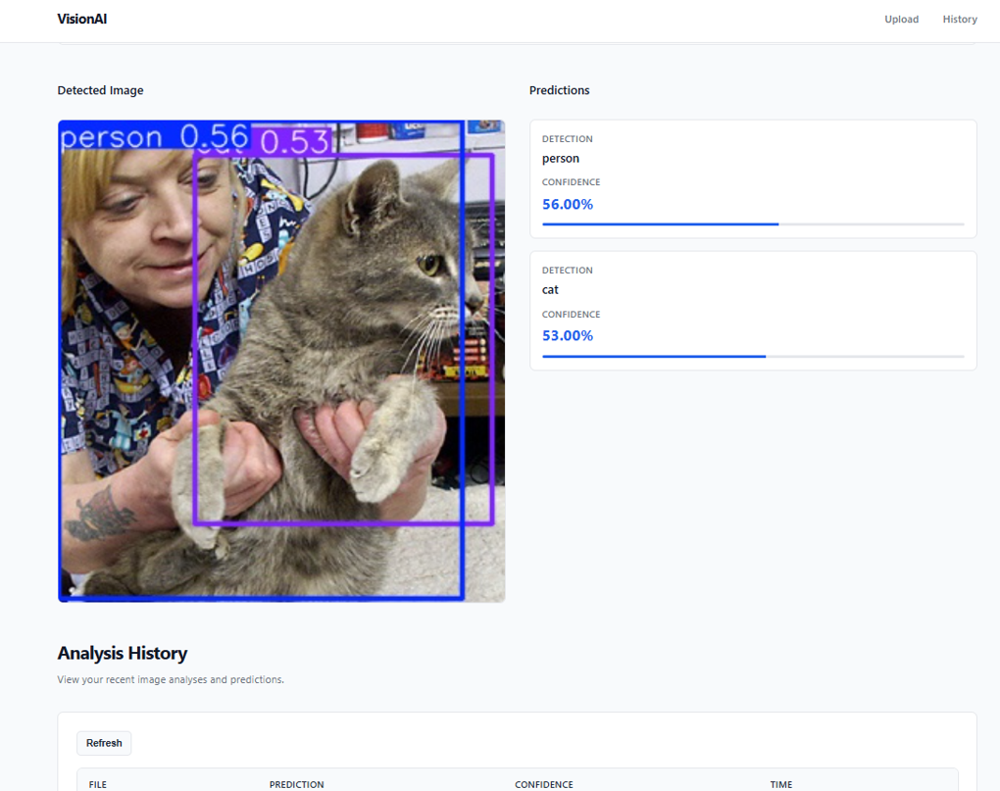

# VisionAI — Image Recognition & Model Serving Platform

VisionAI is a full-stack software application for serving computer vision inference through a REST API and web interface. The system provides an end-to-end workflow for image upload, asynchronous-friendly API-based processing, object detection, persistent result storage, and historical result retrieval.

The project is designed as a software engineering implementation rather than a standalone machine learning experiment. It focuses on backend API design, database integration, frontend-backend communication, application structure, persistence, error handling, and containerized deployment, with YOLOv8 integrated as the inference component.

## Overview

VisionAI allows users to upload an image through a browser-based interface and submit it to a FastAPI backend.

The backend:

1. Receives and stores the uploaded image.
2. Passes the image to the YOLOv8 inference service.
3. Processes the returned detections.
4. Generates an annotated image.
5. Persists prediction records in PostgreSQL.
6. Returns structured JSON to the frontend.
7. Exposes a history endpoint for retrieving previously stored results.

The frontend consumes the REST API and presents the results through a simple web interface.

This architecture separates the presentation, application/API, inference, and persistence layers, making the project suitable for further deployment and extension.

## Application Preview

The following screenshot shows the application after an image has been processed, including the annotated image, detected objects, confidence values, and prediction history.




## Key Features

### Image Upload and Processing

- Browser-based image selection and preview
- Multipart file upload through the REST API
- Server-side image storage
- Support for common image formats
- Annotated output image generation

### REST API

FastAPI provides the application's backend API layer.

The API exposes endpoints for:

- Health checks
- Image prediction
- Prediction history

The API can also be tested interactively through automatically generated Swagger documentation.

### Object Detection Integration

YOLOv8 is integrated as the inference engine.

The application receives model detections and converts them into application-level prediction records containing the detected class and confidence score.

### Persistent Data Storage

PostgreSQL stores prediction history so that application results remain available after refreshing or reopening the frontend.

SQLAlchemy provides the ORM layer between the Python application and PostgreSQL.

### Dynamic Frontend

The frontend communicates with the backend using the browser Fetch API and dynamically updates the interface without requiring a full page reload.

It provides:

- Image preview
- Detection result cards
- Confidence indicators
- Annotated image display
- Historical prediction table
- Manual history refresh

### Containerized Deployment

The project is structured for Docker-based deployment, allowing the backend and PostgreSQL database to run as isolated services.

Docker Compose can be used to orchestrate the application and database together.

## System Architecture

```text
                         Client Browser
                              |
                              | HTTP / REST
                              v
                    +----------------------+
                    |      Frontend        |
                    | HTML / CSS / JS      |
                    +----------+-----------+
                               |
                               | REST API
                               v
                    +----------------------+
                    |     FastAPI API      |
                    |  Application Layer   |
                    +----------+-----------+
                               |
                    +----------+-----------+
                    |                      |
                    v                      v
          +----------------+      +----------------+
          |   YOLOv8       |      |   PostgreSQL   |
          | Inference      |      |   Persistence  |
          +-------+--------+      +----------------+
                  |
                  v
          Annotated Image
                  |
                  +----------------------+
                                         |
                                         v
                              JSON Response / UI
```

## Request Flow

```text
User uploads image
        |
        v
Frontend creates multipart/form-data request
        |
        v
POST /predict
        |
        v
FastAPI receives request
        |
        v
Image stored in uploads/
        |
        v
YOLOv8 performs inference
        |
        v
Detections processed by backend
        |
        +----------------------+
        |                      |
        v                      v
Annotated image          Prediction records
                              |
                              v
                         PostgreSQL
        |
        v
JSON response
        |
        v
Frontend renders results
        |
        v
GET /history
        |
        v
Historical records displayed
```

## Technology Stack

| Layer | Technology |
|---|---|
| Backend Language | Python |
| API Framework | FastAPI |
| Application Server | Uvicorn |
| ORM | SQLAlchemy |
| Database | PostgreSQL |
| Database Driver | psycopg2 |
| Inference Engine | YOLOv8 / Ultralytics |
| Frontend | HTML, CSS, JavaScript |
| HTTP Communication | Fetch API / REST |
| Configuration | python-dotenv |
| API Documentation | Swagger UI / OpenAPI |
| Containerization | Docker |
| Service Orchestration | Docker Compose |

## Project Structure

```text
ML-Serving-API/
│
├── backend/
│   ├── __init__.py
│   ├── main.py
│   ├── model.py
│   └── database.py
│
├── frontend/
│   ├── index.html
│   ├── script.js
│   └── style.css
│
├── uploads/
│   └── sample/
│       └── ...
│
├── visionai-preview.png
├── yolov8n.pt
├── requirements.txt
├── Dockerfile
├── docker-compose.yml
├── .env
├── .gitignore
└── README.md
```

The `uploads/` directory contains application-generated image files. For a public repository, avoid committing sensitive or unnecessary uploaded user data.

## Backend Architecture

The backend is organized around clear responsibilities.

### `backend/main.py`

Responsible for:

- FastAPI application initialization
- API route definitions
- Startup database initialization
- Image upload handling
- Prediction request processing
- Prediction history retrieval
- Static serving of uploaded/annotated images
- CORS configuration

### `backend/model.py`

Responsible for:

- Loading the YOLOv8 model
- Running inference
- Processing detections
- Producing annotated image output

### `backend/database.py`

Responsible for:

- PostgreSQL connection configuration
- SQLAlchemy engine creation
- Session management
- ORM model definition
- Database table initialization

This separation keeps API routing, inference logic, and persistence concerns independent from one another.

## API Endpoints

### `GET /`

Returns a basic application status response.

Example:

```json
{
  "message": "AI Vision Platform API is running",
  "status": "healthy"
}
```

### `POST /predict`

Accepts an image using multipart form data and performs object detection.

Example request:

```text
POST /predict
Content-Type: multipart/form-data
```

Example response:

```json
{
  "filename": "example.jpg",
  "predictions": [
    {
      "class": "cat",
      "confidence": 0.87
    },
    {
      "class": "person",
      "confidence": 0.56
    }
  ],
  "annotated_image": "uploads/annotated_example.jpg",
  "status": "success"
}
```

### `GET /history`

Retrieves prediction records stored in PostgreSQL.

Example response:

```json
{
  "status": "success",
  "count": 2,
  "data": [
    {
      "id": 2,
      "filename": "example.jpg",
      "prediction": "cat",
      "confidence": "0.87",
      "timestamp": "2026-05-30T11:29:35.062451"
    },
    {
      "id": 1,
      "filename": "example.jpg",
      "prediction": "person",
      "confidence": "0.56",
      "timestamp": "2026-05-30T11:29:35.062451"
    }
  ]
}
```

### `GET /health`

Provides a service health check.

Example:

```json
{
  "status": "healthy",
  "service": "AI Vision Platform"
}
```

## API Documentation

FastAPI automatically generates OpenAPI documentation.

Once the backend is running, Swagger UI is available at:

```text
http://127.0.0.1:8000/docs
```

The documentation can be used to test endpoints independently of the frontend.

## Database Design

The application uses PostgreSQL for persistent prediction storage.

The primary table is:

```text
predictions
```

### Schema

| Column | Type | Purpose |
|---|---|---|
| `id` | Integer | Primary key |
| `filename` | String | Uploaded image filename |
| `prediction` | String | Detected object class |
| `confidence` | String | Detection confidence |
| `timestamp` | DateTime | Prediction creation time |

The application uses SQLAlchemy's ORM to represent this table as a Python model.

At application startup, the database initialization logic creates the required table if it does not already exist.

## Frontend Architecture

The frontend is intentionally lightweight and does not require a JavaScript framework.

### HTML

Defines the application structure:

- Navigation
- Upload interface
- Image preview
- Results section
- History section
- Footer

### CSS

Provides:

- Layout
- Responsive behavior
- Buttons
- Cards
- Tables
- Confidence indicators
- Navigation styling

### JavaScript

Provides the client-side application logic.

Responsibilities include:

- File selection
- Image preview
- API communication
- Loading states
- Rendering prediction results
- Rendering prediction history
- Timestamp formatting
- Error handling
- Manual history refresh

## Data Persistence

Prediction results are persisted independently of the frontend.

For every detected object, the backend creates a database record containing the filename, detected class, confidence score, and timestamp.

This means refreshing the browser does not remove application history.

The persistence flow is:

```text
Prediction
    |
    v
FastAPI
    |
    v
SQLAlchemy Session
    |
    v
PostgreSQL
    |
    v
GET /history
    |
    v
Frontend
```

## Error Handling

The application includes error handling at both the backend and frontend layers.

### Backend

Database operations use transaction handling:

```text
Database operation
       |
       +---- success ----> commit
       |
       +---- failure ----> rollback
```

Database sessions are closed after requests to avoid leaving connections open.

### Frontend

The frontend checks HTTP responses and catches failed requests. When an API request fails, an appropriate error message is displayed instead of leaving the interface in an inconsistent state.

## CORS Configuration

The backend currently uses FastAPI's CORS middleware to allow frontend requests during local development.

For production deployment, the allowed origins should be restricted to the actual frontend domain rather than permitting unrestricted origins.

## Local Development

### Prerequisites

Install:

- Python 3.12
- PostgreSQL
- Git
- A modern web browser

### Clone the Repository

```bash
git clone <YOUR_GITHUB_REPOSITORY_URL>
cd ML-Serving-API
```

### Create a Virtual Environment

Windows:

```bash
python -m venv venv
```

Activate:

```bash
venv\Scripts\activate
```

### Install Dependencies

```bash
pip install -r requirements.txt
```

## Environment Configuration

Create a `.env` file in the project root:

```env
DB_USER=postgres
DB_PASSWORD=YOUR_POSTGRES_PASSWORD
DB_HOST=localhost
DB_PORT=5432
DB_NAME=aivision
```

Never commit real credentials to GitHub.

Add the following to `.gitignore`:

```gitignore
.env
venv/
__pycache__/
*.pyc
```

## PostgreSQL Setup

Create the application database:

```sql
CREATE DATABASE aivision;
```

Ensure PostgreSQL is running before starting the backend.

The application creates the required `predictions` table during startup.

## Start the Backend

From the project root:

```bash
uvicorn backend.main:app --reload
```

The API will be available at:

```text
http://127.0.0.1:8000
```

Swagger UI:

```text
http://127.0.0.1:8000/docs
```

## Start the Frontend

The frontend can be served using Python's built-in HTTP server:

```bash
python -m http.server 5500
```

Open:

```text
http://127.0.0.1:5500/frontend/
```

The FastAPI backend should remain running on port `8000`.

## Docker

The application can be containerized to provide a reproducible runtime environment.

The target container architecture is:

```text
+-----------------------------+
|       Docker Compose        |
|                             |
|  +-----------------------+  |
|  | FastAPI Application   |  |
|  | Python + YOLOv8       |  |
|  +-----------+-----------+  |
|              |              |
|              v              |
|  +-----------------------+  |
|  | PostgreSQL            |  |
|  | Persistent Database   |  |
|  +-----------------------+  |
+-----------------------------+
```

### Build

```bash
docker compose build
```

### Start

```bash
docker compose up
```

Run in detached mode:

```bash
docker compose up -d
```

### Stop

```bash
docker compose down
```

### Persistent Database Storage

PostgreSQL should use a Docker volume so that prediction history survives container recreation.

When running the application through Docker Compose, the database host should reference the PostgreSQL service name rather than `localhost`.

For example:

```env
DB_HOST=postgres
DB_PORT=5432
```

## Deployment Considerations

The current implementation is suitable for development, demonstration, and portfolio deployment.

For production deployment, the following should be considered:

- HTTPS termination
- Reverse proxy such as Nginx
- Restricted CORS configuration
- Authentication and authorization
- Secure secret management
- Request validation
- Upload size restrictions
- File type validation
- Filename sanitization
- API rate limiting
- Structured logging
- Monitoring
- Database backups
- Health checks
- Container resource limits

## Security

The application handles uploaded files and database credentials, so production deployments should apply appropriate security controls.

Recommended controls include:

- Keep `.env` outside version control
- Validate uploaded file types
- Restrict upload sizes
- Sanitize filenames
- Avoid exposing internal database credentials
- Restrict PostgreSQL network access
- Configure CORS for trusted origins only
- Use HTTPS in production
- Add authentication for protected endpoints
- Apply API rate limiting

## Testing Strategy

The API can be tested independently using Swagger UI.

Recommended testing areas include:

### API Tests

- `GET /`
- `GET /health`
- `POST /predict`
- `GET /history`

### Database Tests

- Successful prediction insertion
- Transaction rollback
- History retrieval
- Timestamp persistence

### Frontend Tests

- Image selection
- Image preview
- Successful API request
- Prediction rendering
- History rendering
- Refresh functionality
- API error handling

### Integration Testing

A complete integration test should verify:

```text
Upload image
    ↓
FastAPI
    ↓
YOLOv8 inference
    ↓
PostgreSQL insertion
    ↓
API response
    ↓
Frontend rendering
    ↓
History retrieval
```

## Design Decisions

### FastAPI

FastAPI was selected to provide a lightweight, high-performance Python API layer with automatic OpenAPI documentation and straightforward request handling.

### PostgreSQL

PostgreSQL provides reliable persistent storage for prediction records and represents a production-oriented alternative to storing application state only in local files.

### SQLAlchemy

SQLAlchemy separates application-level database operations from raw SQL and provides structured ORM-based database access.

### Vanilla JavaScript

The frontend uses standard JavaScript and the Fetch API rather than introducing a frontend framework. This keeps the application lightweight while demonstrating direct REST API integration.

### Docker

Docker provides a consistent runtime environment and makes the application easier to reproduce across development and deployment environments.

## Future Improvements

The architecture can be extended with:

1. Authentication and authorization
2. API versioning
3. Pagination for prediction history
4. Search and filtering of historical predictions
5. Batch image processing
6. Configurable confidence thresholds
7. Model selection and model versioning
8. Automated unit and integration testing
9. CI/CD using GitHub Actions
10. Reverse proxy and HTTPS deployment
11. Application monitoring and structured logging
12. Cloud deployment
13. Object storage for uploaded images
14. Background task processing for large inference workloads
15. Database migrations using Alembic

## Engineering Highlights

This project demonstrates software engineering concepts across multiple layers:

- Separation of application responsibilities
- RESTful API design
- ORM-based persistence
- Relational database integration
- Client-server communication
- File handling
- Transaction management
- Error handling
- Environment-based configuration
- API documentation
- Containerization
- Service orchestration
- Deployment-oriented application structure

The machine learning model is therefore treated as one component within a broader software system rather than as the entire application.

## Project Objective

The objective of VisionAI is to build a practical, maintainable software system around an image inference service.

The project combines:

```text
Frontend
   +
REST API
   +
Inference Service
   +
Relational Database
   +
Containerized Runtime
```

This provides a foundation that can be extended into a production-style computer vision service.

## License

This project is intended for educational, portfolio, and demonstration purposes.

If the repository is distributed publicly, add an appropriate open-source license such as the MIT License.

## Author

**Vikas Narlakanti**

